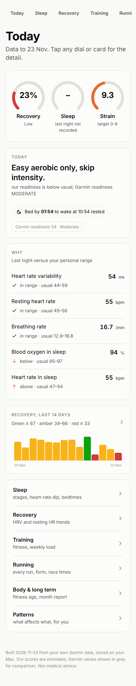

# Garmin-tracking

A free, self-hosted [MCP](https://modelcontextprotocol.io) server that connects your Garmin Connect
account to AI assistants (Claude Desktop, Claude Code, etc.), so you can ask questions about your
health and training data without a paid connector.

> **Status:** v0.16.0. The 43 MCP tools and offline dashboard include touch and mouse chart inspection, Light and Dark modes, and a daily overview with training guidance and linked findings. Optional private phone hosting is off by default.

## What this is, in one minute

A personal alternative to paid Garmin AI connectors (Fitness AI Connector, AthleteData) and to
Whoop/Oura-style scores, for one person with a Garmin Forerunner 955:

1. **Collect:** a sync job pulls *all* Garmin data (official Personal API + unofficial library +
   the one-time account export), with full history, into a local SQLite database.
2. **Compute:** transparent analytics on top: recovery, sleep, strain, training load, race
   predictions, running form, patterns in your own data. Every formula is in
   [METRICS.md](METRICS.md), with sources, and checked against Garmin's own numbers.
3. **Use:** ask Claude through the MCP tools, or open the dashboard (one HTML file, no server).

| Start here | For |
|---|---|
| [HANDOVER.md](HANDOVER.md) | **Start here:** goal, story, every formula with file and source, how ours differs from Garmin and the apps, known issues, what's left |
| [docs/CHATGPT_HANDOVER_PROMPT.md](docs/CHATGPT_HANDOVER_PROMPT.md) | Ready-to-paste prompt for handing the project to ChatGPT |
| [ARCHITECTURE.md](ARCHITECTURE.md) | How the pieces fit, data flow, where each file lives |
| [AGENTS.md](AGENTS.md) | Rules and context for AI assistants (Claude, ChatGPT) working on this repo |
| [ROADMAP.md](ROADMAP.md) | The single plan: phases, versions, open items, what was dropped and why |
| [METRICS.md](METRICS.md) | Every derived metric: formula, source, sense check |
| [DASHBOARD_PLAN.md](DASHBOARD_PLAN.md) | Dashboard UI map, design system, hosting |
| [CHANGELOG.md](CHANGELOG.md) | What changed, per version |
| [MAC_SETUP.md](MAC_SETUP.md) | One-time setup on the Mac |
| `research_notes/` | Competitor, Garmin and science research behind the decisions |


> **Metric design:** [METRICS.md](METRICS.md) explains how each derived metric is calculated (Garmin vs science vs ours).
> **Plan:** [ROADMAP.md](ROADMAP.md) is the single main plan (phases, versions, sources, open items).

## How it works

```
Garmin Connect --(scheduled sync)--> local SQLite (~/.garmin-mcp) <--reads-- MCP server <--> AI assistant
```

The sync job stores every Garmin response verbatim plus parsed FIT streams, so the assistant reads
fast local data and Garmin is called only by the scheduled sync (or the `refresh_data` tool).

It uses the unofficial [`garminconnect`](https://github.com/cyberjunky/python-garminconnect)
Python library, which talks to the same endpoints as the Garmin Connect website.

**Caveat:** this is *not* the official Garmin Health API (that requires a business partnership).
Garmin can change or block these endpoints at any time, which would break the server until the
library is updated. Use your own account only.

## Tools

All analytics read the local database. `refresh_data` contacts Garmin; workout tools can write
to Garmin when requested. `build_dashboard` can publish the HTML when private hosting is enabled.

| Tool | What it returns |
|------|-----------------|
| `health_snapshot(day?)` | One-call picture: sleep, HRV and resting HR vs your baselines, Garmin training readiness (with factors) and status, load, VO2max, race predictions, endurance/hill score, everyday activity, fitness age, last 7 days of activities, and flags |
| `daily_summary(day?)` | Every stored metric for one day |
| `activities(days=30, activity_type?, end?)` | Activities with a per-type summary |
| `activity_detail(activity_id)` | Laps with pace, HR zones, weather, Garmin training effect, load (TRIMP/rTSS, zones), running form from FIT (cadence, ground contact, vertical oscillation, power), swim (pace/100 m, SWOLF by stroke) or strength (sets, reps, volume) |
| `daily_brief(day?)` | Morning report: how recovered and why, a training suggestion with its reason, yesterday, week so far |
| `readiness_today(day?)` | Our transparent readiness (HRV, resting HR, sleep, respiration vs your baselines, each shown) next to Garmin's; HRV normal band; sleep debt; illness/strain flag |
| `recovery_trend(days=28)` | Day-by-day readiness, HRV vs normal band, sleep, Garmin readiness |
| `training_load(days=42)` | Fitness/fatigue/form (CTL/ATL/TSB), ramp, monotony, strain, thresholds (ours + Garmin's) |
| `performance(days=90)` | Pace curve, critical speed, effective VO2max, race predictions (several methods + Garmin's) |
| `weekly_review(end?)` | Last 7 days vs previous 4 weeks: volume, load, intensity, form, recovery |
| `sense_checks(end?)` | Self-checks of our calculations against Garmin's values and physics |
| `run_analysis(activity_id)` | Run deep dive: splits, efficiency, decoupling, HR drift, running form vs your norm at the same pace, similar runs, heat effect, recap facts |
| `running_form_trends(days=365)` | Monthly form and efficiency within your usual pace band |
| `activity_stream(activity_id, every_s=10)` | Downsampled HR/pace/cadence/altitude/power series |
| `sport_trends(sport='swim'\|'strength')` | Swim pace/SWOLF by stroke, or strength sessions/sets/reps |
| `metric_glossary(metric?)` | Meaning, typical range, unit, how to improve |
| `fitness_age()` | Garmin fitness age with its levers and targets |
| `athlete_context()` | Profile, settings, goals, notes and open questions (inputs still needed) |
| `update_athlete_setting(key, value)` | Save a stated input, e.g. tested max HR or goal race; recalculates |
| `add_athlete_note(text, kind)` | Save a note, decision or preference |
| `goal_check()` | Goal race vs current fitness (median of methods, cautions) |
| `workout_templates()` | Easy, tempo, VO2 intervals and calibration-test specs from your HR thresholds |
| `create_workout(spec, upload=False, schedule_date?)` | Validate and build a structured workout; optional upload and schedule to Garmin Connect (Mac) |
| `garmin_workouts(action='list'\|'delete', workout_id?)` | Workouts saved in Garmin Connect (Mac) |
| `sleep_breakdown(day?)` | Garmin sleep score parts (stages, awakenings, restlessness, stress) with ratings and optimal ranges, plus the day-to-night heart-rate dip |
| `long_term_health(day?)` | Pace of ageing, Marathon shape (Runalyze), lasting shifts in resting HR/HRV/sleep, sick/injured days |
| `monthly_report(month?)` | Month vs previous month: sessions, hours, run km, sleep, resting HR, steps, HRV |
| `running_breakdown(activity_id?)` | One run: form vs Garmin's colour bands and vs your usual at that pace, pacing, HR drift, running effectiveness, what to work on |
| `running_form_history(runs=60)` | Per-run form series with your cadence/stride-vs-speed lines |
| `explore_relationships(days=365, top=8)` | Every tested pair ranked, with r, CI, notable flag and per-day points |
| `test_runs()` | Comparable steady runs and the efficiency (speed per heartbeat) trend |
| `recovery_weight_study(days=180)` | Whether each Recovery % signal predicts next-night HRV / tracks Garmin; keeps or changes weights by a fixed rule |
| `daily_scores(day?, history_days=0)` | Recovery %, Sleep %, Strain (0–21) with target, each beside Garmin's value; suggested bedtime |
| `insight_feed(end?)` | Ranked insights: level 1 what happened, level 2 associations in your data, level 3 what to do |
| `relationships(days=365)` | Associations (sleep, stress, bedtime, load → HRV, readiness, sleep), baseline-adjusted with CIs |
| `trends_and_patterns(days=90)` | Robust trends, weekday patterns, streaks, personal ranges, form % |
| `records_and_calendar(days=365)` | Personal-best timeline, longest sessions, per-day calendar data |
| `add_tag(day, tag)` / `tag_impact()` | Tag days (alcohol, travel, ...) and see next-day effects. Tags `sick`, `injured`, `break` also leave the day out of baselines and pause advice |
| `build_dashboard()` | Rebuild the HTML dashboard (also rebuilt after every sync) |
| `trend(metric, days=30)` | Series + averages for any `table.column`, e.g. `daily.resting_hr`, `sleep.sleep_s`, `health_status.hrv`, `readiness.score`, `race_predictions.t5k_s` |
| `refresh_data(days=3)` | Sync recent days from Garmin, then rebuild tables |
| `data_coverage()` | What is stored, date ranges, last sync and errors |

`day` is `YYYY-MM-DD`. Values prefixed `garmin_` are Garmin's own scores.

### Local tables (rebuilt from raw data after every sync/import)

`daily`, `sleep`, `hrv`, `health_status`, `readiness`, `training`, `race_predictions`, `scores`,
`fitness_age`, plus `activities`, `fit_laps`, `fit_records`. When sources overlap, each field is
taken from the official API first, then the unofficial library, then the export (values were
cross-checked and agree).

## Setup

Requires Python 3.12+.

```bash
git clone https://github.com/PrahladRajhans/Garmin-tracking.git
cd Garmin-tracking
python3 -m venv .venv && source .venv/bin/activate
pip install -e .

# 1) Official Personal API key (primary source). Create it at
#    https://connect.garmin.com/app/settings/personalApiToken, then save it to a private file:
mkdir -p ~/.config/garmin && chmod 700 ~/.config/garmin
printf '%s' 'PASTE_YOUR_KEY' > ~/.config/garmin/connect-personal-api-key
chmod 600 ~/.config/garmin/connect-personal-api-key

# 2) Unofficial login (adds training readiness/status, race predictor, endurance/hill score,
#    lactate threshold, acclimation). One-time, supports MFA. Saves tokens to ~/.garminconnect
python -m garmin_mcp.login
```

Never commit the key or paste it into chats or issues. The key file location is the same one
Garmin's official client (`garmin-connect-personal-api-python`) reads; `GARMIN_PERSONAL_API_KEY`
also works. Keys expire (30 days to 1 year), so set a reminder to renew yours.

**Sources:** `--source both` (default) syncs the official API first, then only the extras from the
unofficial library. If either is unavailable it is reported and skipped; the other still syncs.
Use `--source personal_api` for official-only.

After this, the server reuses the saved tokens; your password is not stored.

### Dashboard

`garmin-mcp-dashboard` writes `dashboard/index.html` in your data folder (rebuilt after every
sync). It is one self-contained file with linked pages: Today → Sleep, Recovery, Training,
Running (→ each run), Body, Patterns and History. Hover, tap or slide over a chart for values. Keyboard
users can focus a chart and use arrow keys. Choose **Light** or **Dark** at the top. A bundled
script handles these controls offline. The file has no remote scripts or requests.

- **Mac:** open `~/.garmin-mcp/dashboard/index.html` in Safari (or your `GARMIN_DATA_DIR` override).
  The file is rebuilt after each sync; reload an already open tab to see new data.
- **iCloud:** each build copies the file to `iCloud Drive/Garmin/dashboard.html` if iCloud Drive
  exists. The Mac copy and iPhone Safari/link behavior have **not** been verified here.
- **Private phone hosting:** optional Cloudflare Pages + Access email login. No process needs
  to stay running on the Mac after upload. Follow [MAC_SETUP.md](MAC_SETUP.md#private-phone-access-optional)
  first: production **and** preview addresses must be protected before any health data is uploaded.
  Sync, the dashboard CLI, and `build_dashboard` report publishing errors separately from the local
  build. Publishing is disabled unless explicitly configured; only the HTML and fixed privacy
  headers are uploaded, never the database, FIT files, or credentials.
- **Private Artifact:** a manual snapshot remains an alternative; availability and access controls
  depend on the host. It does not update itself after a sync.

Design and page map: [DASHBOARD_PLAN.md](DASHBOARD_PLAN.md).

The Body page compares Garmin VO₂max and the separate effective pace/HR estimate with the
published FRIEND 2015 age/sex reference. It shows the exact table/source and explains that
neither estimate is a laboratory measurement; the effective estimate depends on HRmax.
No age/sex is assumed when profile data are missing. See [the primary-table transcription](research_notes/Garmin%20connector%20feature%20research/friend_2015_reference.md).

**History** opens day, week, month and year. Date links reveal the underlying recorded
readings and workouts. **Recovery** shows usual ranges and seven-day changes for resting
pulse and overnight metrics when enough readings exist. Open **Running → a recent run
→ Run timeline** to try the optional heart-rate and step-length overlays.

See [the progress audit](docs/PROGRESS_AUDIT.md) for validation and remaining work.

### Import your full history (one time)

Request your data at Garmin (Account → Data Management → Export Your Data), download the ZIP, then:

```bash
garmin-mcp-import ~/Downloads/<your-export>.zip     # or the unzipped folder
```

It loads everything since you started using Garmin: activities with original FIT files, daily
summaries, sleep, health status (overnight HRV/RHR/SpO2/respiration vs baseline), training
readiness, training status, race predictions, endurance/hill score, acute load, VO2max,
acclimation, hydration, personal records, zones. Safe to re-run; activities already synced from
the API are never overwritten.

### Sync your data

```bash
garmin-mcp-sync --days 365     # first run: backfill a year (takes a while, ~25 calls/day)
garmin-mcp-sync                # later runs: last 7 days, only new/changed data is fetched
garmin-mcp-sync --coverage     # show what is stored
```

What gets synced (official Personal API):
- **Daily:** daily summary, sleep, HRV, all-day heart rate, SpO2, fitness age.
- **Windowed (28-day chunks, the API's history cap):** Body Battery, stress, steps, hydration, VO2max, weight, HRV and sleep summaries.
- **Per activity:** summary + original FIT file.

Extras from the unofficial library: training readiness, training status, VO2max/max metrics, respiration, intensity minutes, Body Battery events, heat/altitude acclimation, floors, race predictions, endurance score, hill score, lactate threshold, body composition, plus activity splits, HR/power zones and weather.

In `--source garminconnect` mode (unofficial only):
- **Daily:** summary, sleep, HRV, training readiness, training status, stress/Body Battery, all-day HR, respiration, SpO2, VO2max/max metrics, fitness age, intensity minutes, hydration, Body Battery events, heat/altitude acclimation, floors.
- **Windowed:** race predictions, endurance score, hill score, lactate threshold, body composition, weigh-ins.
- **Per activity:** summary, splits, HR/power zones, weather, original FIT file (1 s records, laps, beat-to-beat HRV) saved in `~/.garmin-mcp/fit/`.

Already-stored days are skipped except the last 2, which Garmin keeps updating. A failing endpoint is logged and skipped; the run stops early after 8 failures in a row (usually expired login).

**Sync gate:** a scheduled run only does a full sync if ≥ 11 hours have passed since the last
one, or if Garmin shows an activity today that isn't stored yet (one cheap call). So a job every
3 hours costs almost nothing, but picks up your morning and night phone syncs. `--force` skips
the gate.

**Schedule it** (every 3 hours), for example on macOS/Linux with `crontab -e`:

```
0 */3 * * * /absolute/path/to/Garmin-tracking/.venv/bin/garmin-mcp-sync >> ~/.garmin-mcp/sync.log 2>&1
```

On Windows, use Task Scheduler to run `garmin-mcp-sync.exe` from `.venv\Scripts`.

### Connect to Claude Desktop

Add to `claude_desktop_config.json` (use the absolute path to your venv):

```json
{
  "mcpServers": {
    "garmin": {
      "command": "/absolute/path/to/Garmin-tracking/.venv/bin/garmin-mcp"
    }
  }
}
```

### Connect to Claude Code

```bash
claude mcp add garmin -- /absolute/path/to/Garmin-tracking/.venv/bin/garmin-mcp
```

## Configuration

Optional environment variables (or a `.env` file, see `.env.example`):

| Variable | Default | Purpose |
|----------|---------|---------|
| `GARMIN_TOKEN_DIR` | `~/.garminconnect` | Where session tokens are stored |
| `GARMIN_EMAIL` / `GARMIN_PASSWORD` | unset | Fallback login if no tokens exist (prefer the login script) |
| `GARMIN_DATA_DIR` | `~/.garmin-mcp` | Database and FIT files |
| `GARMIN_DB_PATH` | `$GARMIN_DATA_DIR/garmin.db` | SQLite file |
| `GARMIN_TZ` | computer's local time | IANA timezone for "today", e.g. `Asia/Kolkata` |
| `GARMIN_DASHBOARD_PUBLISH` | unset (off) | Set to `cloudflare` only after private hosting setup |
| `CLOUDFLARE_ACCOUNT_ID` | unset | Account that owns the dedicated Pages project |
| `CLOUDFLARE_API_TOKEN` | unset | Secret token: Pages Edit and Access applications/policies Read for that account |
| `GARMIN_CLOUDFLARE_PROJECT` | unset | Dedicated Direct Upload project name, without custom domains |
| `GARMIN_DASHBOARD_EMAIL` | unset | Exact email allowed by both Access policies |
| `GARMIN_WRANGLER` | unset | Absolute path to the locally installed Wrangler executable |

The publisher reads these settings from the checkout's ignored `.env` as well as environment
variables; environment variables win. Never commit `.env` or put token values in documentation.
Run `.venv/bin/python -m garmin_mcp.publish --check` to check the account and anonymous login
redirects **without uploading**. A disabled or failed check exits with status 1. Removing
`GARMIN_DASHBOARD_PUBLISH` stops future uploads; existing cloud copies remain protected by Access.

## Development

Sleep score, debt and bedtime use Garmin's sleep need when valid, otherwise the same explicitly
labeled 8-hour planning fallback. It is not a measured personal requirement. Incomplete histories
do not generate reassuring training advice. Heart-rate differences and fitness-age trends are
descriptive estimates; neither is a medical recovery/biological-age diagnosis.

`create_workout` returns problems for malformed steps and targets rather than attempting an
upload. The format supports up to 200 stored steps and 8 repeat nesting levels; durations and
distances must be finite and positive. Athlete numeric/pace/timezone overrides are validated
before saving. Existing tool names and valid workout formats are retained.

The sync gate uses the last fully completed, error-free run of all requested sources. Failed
or interrupted runs retry on the next scheduled execution. Endpoint success alone does not delay
a retry. Dates use `GARMIN_TZ` or the saved athlete timezone. Official activity pagination has a
request limit and rejects repeated pages, reporting a failure instead of silently truncating history.

Self-update fast-forwards only. If dependency installation fails after an update, the CLI stops
before syncing and keeps a `pending-install-*.json` marker in the data directory. The next run
retries installation even when no newer commit exists. See [docs/OPERATIONS.md](docs/OPERATIONS.md)
for the Mac/cloud boundary, backups and recovery. CI covers PRs and `chatgpt/**` topic branches.

```bash
pip install -e '.[dev]'
pytest
ruff check .
garmin-mcp-verify     # data-quality checks on your real data (cross-source, units, fill rates)
```

Project layout:

```
src/garmin_mcp/
  server.py   # MCP tool definitions
  client.py   # Garmin auth + helpers
  login.py    # one-time interactive login
  config.py   # data paths
  db.py       # SQLite schema + storage helpers
  fit.py      # FIT parsing (official garmin-fit-sdk)
  sync.py     # incremental sync engine + CLI
  importer.py # Garmin data export importer
  normalize.py# tidy per-day tables from all sources
  insights.py # health snapshot, daily brief, trends, activity views
  recovery.py # Phase 3: HRV baseline, readiness, illness flag
  loads.py    # Phase 4: thresholds, TRIMP, CTL/ATL/TSB, pace curve, predictions, sense checks
  coaching.py # Phase 5: run analysis, form at matched pace, glossary, fitness age
  athlete.py  # Phase 6: settings, goals, notes, placeholders
  goals.py    # Phase 6: goal reality check
  workouts.py # Phase 7: structured workouts, validation, upload
  engine.py   # Phase 8: insight engine (levels 1-3, statistics)
  dashboard.py# Phase 9: static HTML dashboard (v1 prototype)
  scores.py   # Phase 10: Recovery %, Sleep %, Strain
  autoupdate.py # self-update from GitHub main on every sync
  verify.py   # data-quality checks (garmin-mcp-verify)
  sources/    # garminconnect (unofficial), personal_api (pending key)
tests/
```

Every change must add an entry to [CHANGELOG.md](CHANGELOG.md) and keep this README in sync.

## License

MIT

### Dashboard reliability and privacy (v0.14.1)

A fresh database now opens a waiting-for-data dashboard. Charts have expandable exact-value
 tables, visible keyboard focus and date spacing that preserves gaps. Today uses current-day
measurements; missing baselines remain explicit. See [the UI review](docs/UI_REVIEW.md).
New database/dashboard files are owner-only on POSIX; existing permissions are preserved.
Local and iCloud HTML replacement is atomic, and an iCloud failure leaves the local copy usable.

MCP tool results pass to your chosen AI client/model provider when you request them. Optional
Cloudflare hosting uploads a health-data HTML snapshot to Cloudflare behind Access. Neither
choice means those providers cannot process the data; keep both opt-ins deliberate.

Open **Body → Month report** for six months of sleep, HRV and running with observation counts,
or **Running → a run → Pacing and effort** for split times beside watch fields. On the Mac,
`garmin-mcp-verify --run-timing` reads the stored history and reports aggregate differences by
year. The command needs a local database and performs no sync or upload.
