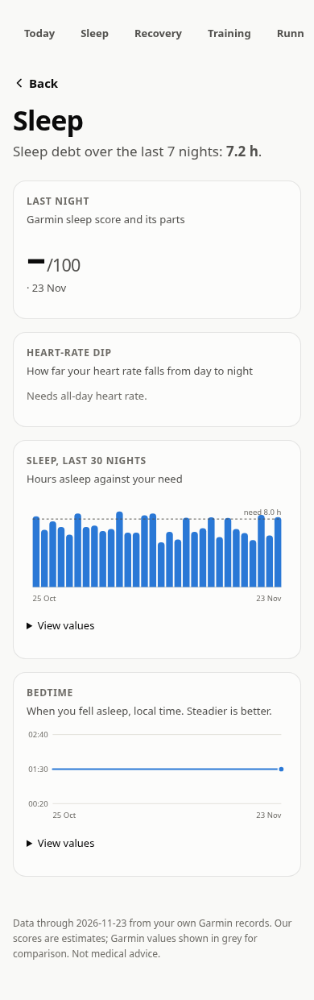
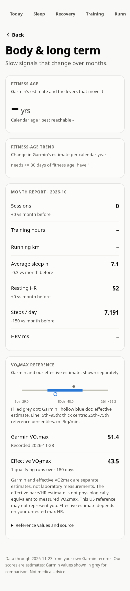
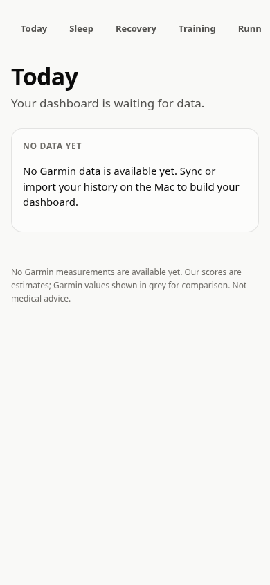

# Dashboard review — v0.14.1, 23 November 2026

## Follow-up review — 24 November 2026

The review used the public Garmin Connect Home example and synthetic archive data. Garmin
puts the activity list, a large focus card and compact metrics in distinct groups. The dashboard
gives daily guidance the largest card, pairs it with today's workouts on desktop, and puts the
primary tabs at the bottom on phones. [Garmin Connect public preview](https://connect.garmin.com/)
and [Garmin's Home layout guide](https://support.garmin.com/en-GB/?faq=35qboQSvKC2WpKkTaDaRP7).

| Area | Change and review |
|---|---|
| Today | Put daily guidance, current activity, key readings and the week ahead first. A checked AI-prioritized follow-up retains its evidence and link. All qualified findings stay accessible. |
| Sleep and Recovery | Put latest-night breakdown and recovery score ahead of longer charts. Keep devices' scores and project calculations separately labeled. |
| Training, Running and activity records | Lead with weekly review and recent workout links. Fold longer lists and race planning estimates behind disclosures. Put a run's numbers ahead of form charts and support jumps to splits, timeline and matched runs. |
| Trends, Body, Patterns and History | Verify the evidence links, confidence figures, population reference and day/week/month/year navigation. Add earlier and later recorded-day links and suppress links to workout details outside the retained window. |
| Charts, navigation and scrolling | Keep tabs available on long pages, move focus to new page headings, and initialize chart controls on demand. Use compact readouts while retaining more room for timeline readings with weather and overlays. |

Chromium and WebKit loaded 69 generated routes in both themes across phone, tablet and desktop
viewports, for 828 page checks. The sweep opened disclosures, checked chart bounds, overflow,
fragment links, duplicate IDs and runtime errors, and exercised Back, keyboard chart navigation,
phone tap, chart overlay controls, and vertical touch scrolling in Chromium. Core navigation
also passed with scripts disabled. The independent review separately checked 348 page and run
section states in Chromium.

The larger synthetic snapshot is about 1.5 MB. The 600 KB goal and load time on a physical
iPhone still need work. Browser engine checks used Linux and localhost. Safari on the owner's Mac,
iCloud sync and Files preview remain device acceptance checks in [the roadmap](../ROADMAP.md).

## Original review — 23 November 2026

Review uses the Product Design audit workflow: inspect screenshots, trace each task, make small
repairs, then check the result. Screenshots below are **synthetic data**, not the owner's health
records. The original repository screenshots and v0.14.0 synthetic screens were inspected first.
The existing card hierarchy, system typography and static HTML delivery are retained.

| Step / question | What worked | Finding and repair | Remaining check |
|---|---|---|---|
| Today: what should I do? | Scores link to their explanations; one daily recommendation | Stale health-status values and thin-data advice could mislead. Use same-day data, prior-day ranges, signal coverage and a partial-sync warning. Empty data has a waiting state. | Owner checks explanations against current Garmin data |
| Sleep: how was my night? | Duration, need and bedtime are separate | Low-contrast small text and pointer-only values. Darker muted text, visible focus and native exact-value disclosures. No blood-pressure cutoff applied to HR. | Safari disclosures and VoiceOver |
| Recovery: what changed? | Personal band gives useful context | Missing bounds/stale values now calibrate; trend copy avoids diagnosis. Dates retain gaps and table includes band values. | Owner's actual baseline coverage |
| Training: how much have I done? | Weekly load and longer trend answer different questions | Label changed to training load, with exposure caveat and decimal ticks. Charts show underlying displayed values. | Real training history and physical-unit checks |
| Running / run detail: what can I improve? | Run drill-down and pace-matched form comparisons are useful | No usual-form claim without comparison history; invalid predicted form cannot divide by zero. Drift does not establish aerobic fitness. Race table scrolls inside its region with an uncertainty caption. | More comparable runs, tested HRmax, watch behavior |
| Body: what is changing slowly? | Separate Garmin/effective markers and explicit source | Fitness-age trend no longer claims biological ageing. Missing profile stays explicit; exact population table stays separate from personal estimates. | Recorded live profile and representativeness |
| Patterns: what moves together? | Confidence and effect details accompany scatter plots | Replace causal-looking pair titles with “&”; add accessible adjusted-value tables. Statistical thresholds unchanged. | Broader real-data stability and source calibration |

## Evidence

- **116 tests** pass; Ruff passes. Synthetic `verify.run` reports no mapping/range problems.
- Chromium/Playwright checks **276 states**: 320, 390, 768, 834, 1024 and 1200 px; light/dark;
  all seven pages plus one run with all disclosures closed and open; seven empty-data pages.
  Every state has one intended visible page, no document overflow, broken fragment links,
  page errors or scripts. Internal table scrolling is intentional.
- Keyboard focus has a computed 3 px outline in all 24 viewport/theme/data combinations.
  Navigation and disclosure rows are at least 44 px high. Main landmark and named navigation
  are present; chart tables have captions and scoped headers.
- Calculated sRGB contrast for muted text: **5.19:1** on the light card and **6.92:1** on the
  dark card; **5.01:1** / **7.73:1** on their page backgrounds. Disclosure/back-link text uses
  primary ink. Status icons are accompanied by text. This is not a full WCAG conformance claim.
- MCP stdio initialization finds all **43 tools**. `data_coverage` and `build_dashboard` succeed
  on populated and empty synthetic databases. No live sync, account access or workout write.
- Atomic-replacement tests preserve old HTML on failure; iCloud-copy failure retains the local
  result; POSIX tests check private new-file/directory modes. Existing permissions stay unchanged.

The browser loads HTML with `page.setContent` because local file navigation is blocked by the
cloud browser policy. This does not prove Safari file/iCloud navigation, VoiceOver behavior,
Cloudflare Access policies in a real account, or unattended Mac updates. Those remain in ROADMAP.

## Screens inspected

[Today before](screenshots/review-2026-11/today-before.png) ·
[Run before](screenshots/review-2026-11/run-before.png) ·
[Patterns before](screenshots/review-2026-11/patterns-before.png)

[Patterns after](screenshots/review-2026-11/patterns-after.png) ·
[Desktop dark with table and keyboard focus](screenshots/review-2026-11/desktop-dark.png)

## References and limits

- [WCAG 2.2 contrast minimum](https://www.w3.org/WAI/WCAG22/Understanding/contrast-minimum.html):
  4.5:1 normal text, 3:1 large text; retrieved 23 November 2026.
- [WCAG focus visible](https://www.w3.org/WAI/WCAG22/Understanding/focus-visible.html): keyboard
  users must see focus; retrieved 23 November 2026. Target size and focus checks here are limited
  to the rendered controls described above.
- Scientific claims and population-table provenance: [accuracy review](../research_notes/Garmin%20connector%20feature%20research/accuracy_review_2026-11.md)
  and `METRICS.md`. No new physiological formula or recovery weighting is introduced here.
- Competitor context remains in `DASHBOARD_PLAN.md` and existing research notes. No logged-in
  competitor app was accessed in this review; no new parity claim is made from marketing pages.

The single plan is `ROADMAP.md`: live private hosting/device checks and owner feedback next;
race/taper work waits for an actual goal. No production hosting was activated in this review.

### Run pacing follow-up (v0.14.2)

The new [pacing drill-down screenshot](screenshots/review-2026-11/run-pacing.png) shows a
synthetic run on a 390 px viewport. The watch duration and stream span are separate
values. Chromium checked 300 page/theme/viewport/disclosure states, including the new
run screen, without page overflow, broken fragment links, scripts or page errors.

### Monthly history and Patterns follow-up (v0.14.3)

[Monthly history on a phone](screenshots/review-2026-11/month-phone.png) ·
[Monthly history in dark mode](screenshots/review-2026-11/month-desktop.png) ·
[Patterns evidence](screenshots/review-2026-11/patterns-evidence.png)

The screens use synthetic coverage gaps. The phone layout displays every main link without
horizontal scrolling. Actual browser clicks verified Running → run → Pacing and effort,
Body → Monthly history, and the corresponding back links and evidence disclosures.
Across 324 rendered states, no page overflow, broken fragment links, script tags or page
errors were observed. Live Safari and device hosting remain verification tasks.

## Direct interaction review (v0.15.0)

Fresh captures use synthetic Garmin records, including enough history to exercise the
insight engine. The audit checks the tasks of deciding how to train, looking up a reading,
understanding a pattern, checking a split and reviewing training context.

1. **Today.** Guidance previously sat below the scores and engine results were missing
   from the page. The plan, scores and linked findings now lead the page. The appearance
   switch sits above navigation. [Before](screenshots/direct-interaction/01-today-before.png)
   · [After on phone](screenshots/direct-interaction/01-today-after.png)
2. **Sleep.** The graph looked passive and the value disclosure moved the content during
   lookup. A touch selects a dated value and moving horizontally changes it. A vertical
   gesture still scrolls. Latest duration leads the page.
   [Before](screenshots/direct-interaction/02-sleep-before.png)
   · [Selected bar on phone](screenshots/direct-interaction/02-sleep-after.png)
3. **Patterns.** The axes were faint and lacked a numeric scale. Both axes now have units,
   signs, visible zero lines and a cursor. Selecting a dot shows both dates and values.
   Keyboard focus remains visible. [Before](screenshots/direct-interaction/03-patterns-before.png)
   · [Dark on laptop](screenshots/direct-interaction/03-patterns-after.png)
4. **Pacing.** Tapping a split shows the kilometre and elapsed time; navigation back to the
   run remains available. [Selected split on phone](screenshots/direct-interaction/04-pacing-after.png)
5. **Training.** A seven-day summary now combines recorded workouts, change context and
   sleep coverage before the load charts. [Training recap on laptop](screenshots/direct-interaction/05-training-after.png)

Chromium checked 200 page and theme states at 320–1280 px, including the navigation
breakpoint. Interaction checks exercised mouse hover and drag, touch tap and horizontal
scrub, vertical scrolling, keyboard selection, theme persistence and run drill-down.
No remote asset requests, document overflow or page errors were observed. A second
browser engine, Linux WebKit, passed phone-size touch and laptop hover on all three chart
types, theme persistence, and opening the interactive dashboard as a local file.
With scripts disabled, static charts, native chart titles and links still rendered.
The iPhone Files preview and physical-device assistive technology remain unverified.

Direct taps provide an alternative to dragging. SVG labels, selection status and keyboard
navigation were checked during the flow. These are scoped checks, not an accessibility
certification. [W3C dragging guidance](https://www.w3.org/WAI/WCAG22/Understanding/dragging-movements.html)
· [MDN touch-action behavior](https://developer.mozilla.org/en-US/docs/Web/CSS/touch-action)

### Cursor and scroll polish (v0.15.1)

The selected point and both guide lines have less visual weight. Chromium rechecked the
200 layouts and actual mouse, keyboard and touch inputs. A vertical gesture started on a
different bar scrolled the page while retaining the already selected reading. Horizontal
scrubs continued to select exact points. Mouse updates are synchronized to animation frames.

### Personal context and telemetry trial (v0.16.0)

[Resting pulse on phone](screenshots/personal-context/resting-pulse-phone.png) shows the
daily readings, seven-day average, and personal range. [Paired telemetry on phone](screenshots/personal-context/run-overlays-phone.png)
shows the optional HR and step-length traces with actual values in the cursor readout.
Both captures use synthetic records.

Chromium verified 280 layout states in both themes from 320 to 1280 px. It exercised
pointer, tap, scrub, scrolling, keyboard, the two overlay toggles and history navigation.
The test opened week, day, year, a prior month and a day in that month. An approximately
1.9 MB snapshot with 371 day panels showed no overflow, broken links, page errors, remote
asset requests, or overlapping sections in the checked states. Linux WebKit rechecked
the main chart gestures, theme persistence and local file opening. The 124 Python tests
and MCP smoke checks cover data, coverage, charts and the updated tool responses.

## v0.17.0 matched runs and conditions

- Synthetic screenshots show the [phone comparison](screenshots/matched-runs/phone-comparison.png),
  [phone conditions cursor](screenshots/matched-runs/phone-conditions.png) and
  [laptop comparison in dark mode](screenshots/matched-runs/laptop-dark-comparison.png).
- Chromium exercised 260 combinations of page, width (320–1280 px) and theme.
  WebKit exercised 26 at phone width. The flows opened the run and its evidence through
  links and checked tap, hover, keyboard, matched-run readings, the heart-rate overlay,
  two AQI windows and an uncovered gap. The timed chart stays in place during selection.
  The check detected no horizontal page overflow, broken internal anchors or outside
  requests. These fixtures contain synthetic readings. Physical iPhone Files and a live
  private hosting session still need verification.
- MCP stdio advertised 44 tools. A populated fixture returned the same effort evidence
  through both run tools and returned 27 readiness pairs. Empty data returned
  insufficient coverage and still built a usable HTML file.

## Today-first flow (v0.19.0)

1. **Today.** The previous screen put three gauges, the training cue and a wide recovery
   chart in the same overview. The new screen leads with a dated action, then readings
   and the seven-day plan. The first-viewport check passed on the synthetic example.
2. **Recovery and Trends.** A named link opens the relevant detail. The 14-day chart
   starts closed and its SVG is capped at 168 pixels. The shorter navigation stays on
   one row. History links also work in a script-disabled view.
3. **Running.** The prior comparison only graphed percentage change from the workout
   median. The new timeline labels pace and the optional heart-rate track in actual
   units. Keyboard selection and the condition readout use the same elapsed point.

The source audit used the current Garmin public app screenshots. The signed-in app
was not accessible to the browser tools. No owner account data was copied. Chromium
and WebKit exercised 228 synthetic viewport/theme/page states, including a small
320 × 568 viewport, and checked missing-data and incomplete-sync handling. These
checks do not establish native iPhone Files performance or ease of use on real data.
See the [reference-to-build table](../research_notes/Garmin%20connector%20feature%20research/owner_reference_review_2026-11.md).

Synthetic comparison screenshots: [Today on a phone](screenshots/today-flow/phone-today.png),
[Today on a laptop](screenshots/today-flow/desktop-today.png) and
[the aligned workout tracks in Dark](screenshots/today-flow/phone-run-comparison.png).

## Measured conditions (v0.20.0)

Chromium and WebKit opened each comparison from its normal navigation path with
synthetic, sufficiently covered source windows. The room disclosure shows the recorded
dates, the two groups and their morning energy check-ins. The workout card keeps
the earlier weather and heart-rate medians together and labels the AQI standard.
Weather readouts are deduplicated in the HTML and the original workout unit stays
visible during the comparison. See [bedroom](screenshots/conditions-evidence/bedroom-phone.png)
and [similar workouts](screenshots/conditions-evidence/similar-runs-phone.png).

## v0.25 coaching review

The coaching surfaces follow the existing navigation. Today links wake-time evidence to
individual recorded nights. Training links completed sessions to retained activities. Sleep
compares the Garmin score between groups of rested ratings and labels sparse tag evidence.
The latest run can include a distance-aligned elapsed-time chart. See the
[paid feature research](../research_notes/Garmin%20connector%20feature%20research/paid_coaching_2026-11.md)
for the feature decisions.

## Interpretation and archive replay

The interpretation now precedes the weekly plan. An accent rule and larger observation text
give it a distinct reading order. It names its lens and its evidence disclosure
distinguishes earlier snapshot readings and links current readings to their source areas.
A synthetic 36-month replay checks HTML structure and archive immutability separately from
viewport tests. See [the repository review](REPOSITORY_REVIEW.md).

## Running performance

Checked a synthetic archive with 16 qualifying efforts in Chromium at 390 px and 1360 px.
Verified that the AI evidence links open the intended section, the four-week and effort
views are readable, and the form references open from an activity. The Kilometre splits
control displayed four full-distance crossings on each of three timeline charts, including
the first at 5:24. It worked alongside the step-length overlay and in the script-disabled
mobile view. The Training trend definition was visible. Physical Safari and iPhone remain
device checks.

## Current Light and Dark acceptance work

For v0.27.0, Chromium checked nine pages on a generated dashboard at 320, 390, 768 and
1200 px in Light and Dark. The 72 page, width and theme combinations passed the overflow
and runtime error checks. The split checkbox accepted keyboard focus and its elapsed guides
aligned across all three charts. The overlay remained readable with splits enabled. A 390 px
run view also rendered with JavaScript disabled.

An independent pass ran 348 route and viewport checks and six offline navigation, back and
scroll checks on a fresh Chromium fixture. A separate build checked Sleep both before and
after accepting a target, including a linked night and the Past week chart.

Split guides measured 3.28:1 in Light and 5.35:1 in Dark against their chart background.
Overlay readout text measured 6.22:1 in Light and 8.69:1 in Dark against its surface.
The remaining [dashboard checks](../ROADMAP.md#3039-make-both-themes-readable-across-the-whole-dashboard)
include physical iPhone Safari and Files, sparse-data states and other chart/label combinations.

For v0.27.1, the running timeline and pace-versus-pulse markers have a 0.95 SVG-unit radius.
Other scatter plots use 1.6. The selected point has a 3.3 radius. Chromium verified these
sizes, nearest-point touch selection and keyboard navigation at 320, 390 and 1200 px in both
themes. The plotted sample count is unchanged. The physical Safari check remains open.

## Chart reading by series and density

- Running and workout overlays identify the series with solid and dashed strokes and label the
  active axis. The neutral overlay palette leaves red, amber, green, blue and purple available
  for Garmin reference bands. Band-colored trace segments follow the available samples.
  Line colors describe the sampled bands. The point readout shows the exact recorded value
  and band. Compare form at similar paces.
- Running exposes more elapsed-time pairs and keeps a dedicated Power chart in a disclosure
  on workouts with sufficient power samples. Sleep offers duration and Garmin score by date
  for weeks and months with at least three paired readings. Training compares recent and
  longer-term load on one scale in load points. Comparisons leave gaps where data is missing.
- Scatter plots use larger dots for small groups (12 or fewer). On Pace and effort, each dot
  represents one workout and up to six dated pairs are expanded initially. Keep the separate
  second-half efficiency statistic below the paired values. Patterns labels the dashed fitted
  relationship, and goal bars reserve semantic colors for actual goal status.
- Chromium used a four-run generated fixture with varied cadence, FIT power, sleep scores,
  and load. It checked nine pages at 320, 390, 768 and 1200 px in both themes, verified keyboard
  readouts, band keys, switching overlays, split guides, and the JavaScript-disabled primary
  charts. Physical iPhone Safari and the owner's Garmin snapshot remain separate checks.
