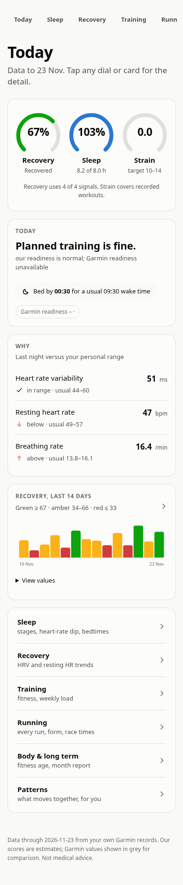
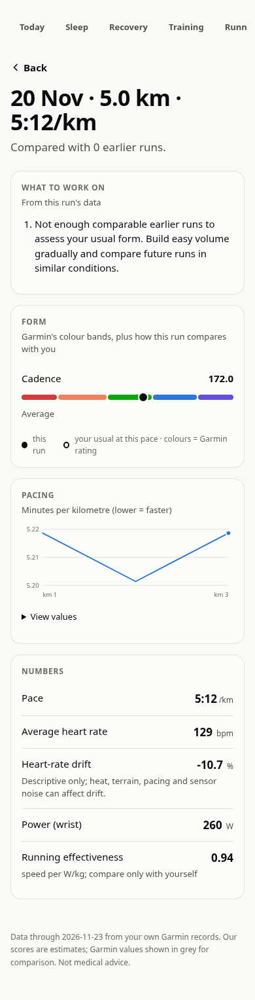

# Dashboard review — v0.14.1, 23 November 2026

Review uses the Product Design audit workflow: inspect screenshots, trace each task, make small
repairs, then check the result. Screenshots below are **synthetic data**, not the owner's health
records. The original repository screenshots and v0.14.0 synthetic screens were inspected first.
The existing card hierarchy, system typography and static HTML delivery are retained.

| Step / question | What worked | Finding and repair | Remaining check |
|---|---|---|---|
| Today: what should I do? | Scores link to their explanations; one daily recommendation | Stale health-status values and thin-data advice could mislead. Use same-day data, prior-day ranges, signal coverage and a partial-sync warning. Empty data has a waiting state. | Owner checks explanations against current Garmin data |
| Sleep: how was my night? | Duration, need and bedtime are separate | Low-contrast small text and pointer-only values. Darker muted text, visible focus and native exact-value disclosures. No blood-pressure cutoff applied to HR. | Safari disclosures and VoiceOver |
| Recovery: what changed? | Personal band gives useful context | Missing bounds/stale values now calibrate; trend copy avoids diagnosis. Dates retain gaps and table includes band values. | Owner's actual baseline coverage |
| Training: how much have I done? | Weekly load and longer trend answer different questions | Label changed to training load, with exposure caveat and decimal ticks. Charts show underlying displayed values. | Real training history and physical-unit checks |
| Running / run detail: what can I improve? | Run drill-down and pace-matched form comparisons are useful | No usual-form claim without comparison history; invalid predicted form cannot divide by zero. Drift does not establish aerobic fitness. Race table scrolls inside its region with an uncertainty caption. | More comparable runs, tested HRmax, watch behavior |
| Body: what is changing slowly? | Separate Garmin/effective markers and explicit source | Fitness-age trend no longer claims biological ageing. Missing profile stays explicit; exact population table stays separate from personal estimates. | Recorded live profile and representativeness |
| Patterns: what moves together? | Confidence and effect details accompany scatter plots | Replace causal-looking pair titles with “&”; add accessible adjusted-value tables. Statistical thresholds unchanged. | Broader real-data stability and source calibration |

## Evidence

- **116 tests** pass; Ruff passes. Synthetic `verify.run` reports no mapping/range problems.
- Chromium/Playwright checks **276 states**: 320, 390, 768, 834, 1024 and 1200 px; light/dark;
  all seven pages plus one run with all disclosures closed and open; seven empty-data pages.
  Every state has one intended visible page, no document overflow, broken fragment links,
  page errors or scripts. Internal table scrolling is intentional.
- Keyboard focus has a computed 3 px outline in all 24 viewport/theme/data combinations.
  Navigation and disclosure rows are at least 44 px high. Main landmark and named navigation
  are present; chart tables have captions and scoped headers.
- Calculated sRGB contrast for muted text: **5.19:1** on the light card and **6.92:1** on the
  dark card; **5.01:1** / **7.73:1** on their page backgrounds. Disclosure/back-link text uses
  primary ink. Status icons are accompanied by text. This is not a full WCAG conformance claim.
- MCP stdio initialization finds all **43 tools**. `data_coverage` and `build_dashboard` succeed
  on populated and empty synthetic databases. No live sync, account access or workout write.
- Atomic-replacement tests preserve old HTML on failure; iCloud-copy failure retains the local
  result; POSIX tests check private new-file/directory modes. Existing permissions stay unchanged.

The browser loads HTML with `page.setContent` because local file navigation is blocked by the
cloud browser policy. This does not prove Safari file/iCloud navigation, VoiceOver behavior,
Cloudflare Access policies in a real account, or unattended Mac updates. Those remain in ROADMAP.

## Screens inspected

[Today before](screenshots/review-2026-11/today-before.png) ·
[Run before](screenshots/review-2026-11/run-before.png) ·
[Patterns before](screenshots/review-2026-11/patterns-before.png)

[Patterns after](screenshots/review-2026-11/patterns-after.png) ·
[Desktop dark with table and keyboard focus](screenshots/review-2026-11/desktop-dark.png)

## References and limits

- [WCAG 2.2 contrast minimum](https://www.w3.org/WAI/WCAG22/Understanding/contrast-minimum.html):
  4.5:1 normal text, 3:1 large text; retrieved 23 November 2026.
- [WCAG focus visible](https://www.w3.org/WAI/WCAG22/Understanding/focus-visible.html): keyboard
  users must see focus; retrieved 23 November 2026. Target size and focus checks here are limited
  to the rendered controls described above.
- Scientific claims and population-table provenance: [accuracy review](../research_notes/Garmin%20connector%20feature%20research/accuracy_review_2026-11.md)
  and `METRICS.md`. No new physiological formula or recovery weighting is introduced here.
- Competitor context remains in `DASHBOARD_PLAN.md` and existing research notes. No logged-in
  competitor app was accessed in this review; no new parity claim is made from marketing pages.

The single plan is `ROADMAP.md`: live private hosting/device checks and owner feedback next;
race/taper work waits for an actual goal. No production hosting was activated in this review.

### Run pacing follow-up (v0.14.2)

The new [pacing drill-down screenshot](screenshots/review-2026-11/run-pacing.png) shows a
synthetic run on a 390 px viewport. The watch duration and stream span are separate
values. Chromium checked 300 page/theme/viewport/disclosure states, including the new
run screen, without page overflow, broken fragment links, scripts or page errors.
